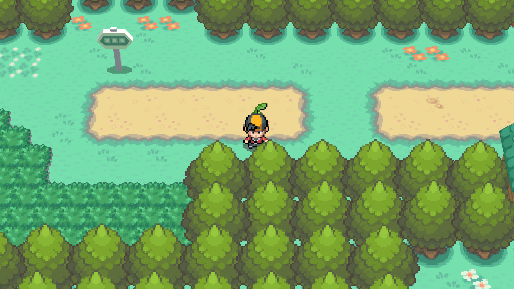
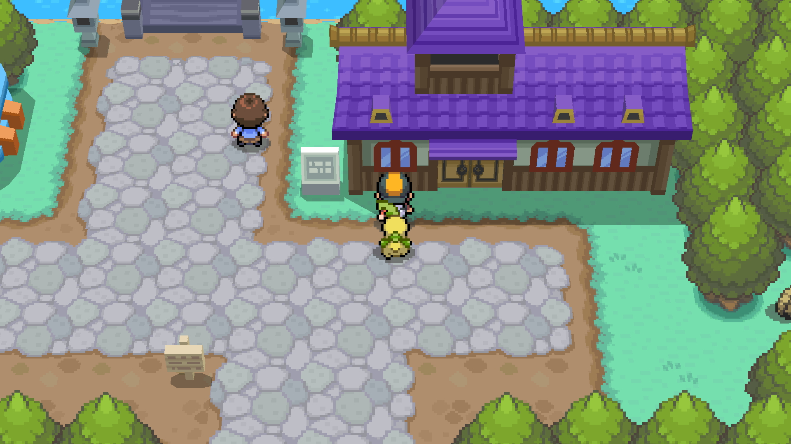
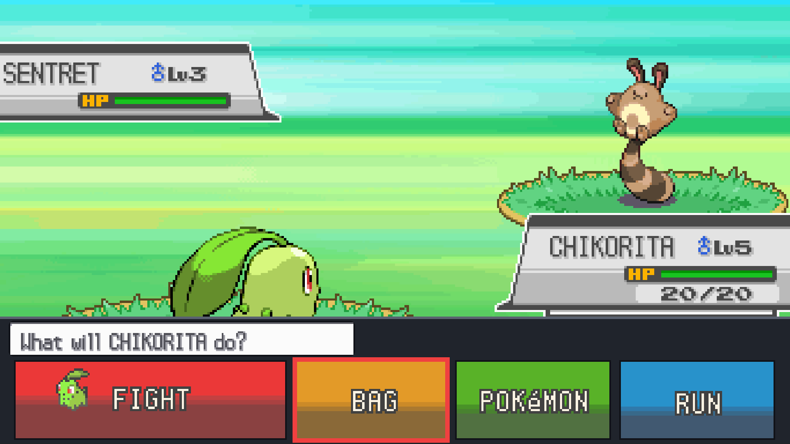
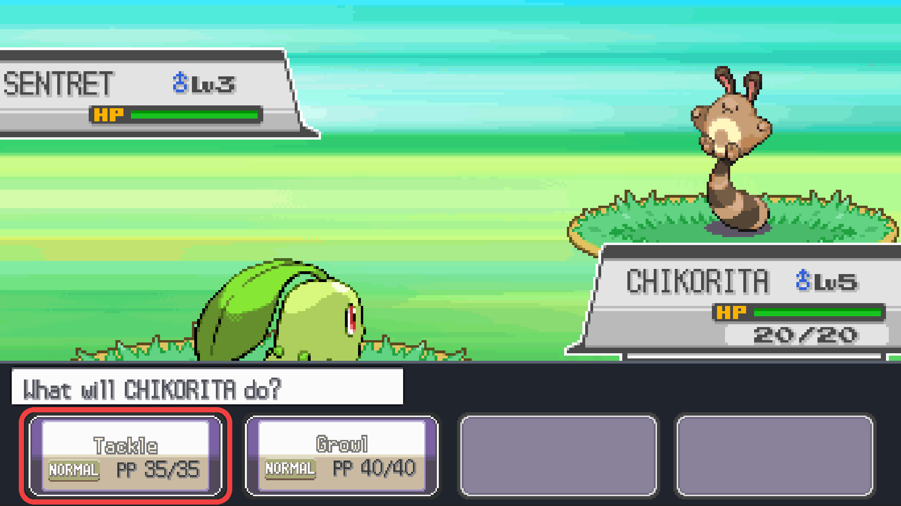

# pokeheartgold-single-screen

A decompilation of Pokémon HeartGold and SoulSilver with a single-screen
build mode (`SINGLE_SCREEN`). It is the source that
[ssrecomp](https://github.com/ClickingMaster/ssrecomp) recompiles into a native
build of Pokémon SoulSilver for single-screen devices. The code is a fork of
[pret/pokeheartgold](https://github.com/pret/pokeheartgold), and the original
tooling and decompilation are pret's work.

Fully decompiled: everything is C/C++ and both ROMs build byte-for-byte in the
normal configuration. The single-screen build changes the game so that
everything fits on one screen: the touch-screen parts of the interface
(battle commands and moves, the bag, the party) are drawn where the top screen
is, and the build publishes its menu and selection state so the ssrecomp
frontend can lay it out for widescreen displays and controllers.

**Made with heavy use of AI.** Nearly all of the changes in this fork were
written by an AI coding assistant (Anthropic's Claude, through Claude Code),
directed and play-tested by the maintainer. Expect bugs a person would not have
made, and review the code with that in mind before reusing it.

**This repository contains no game assets.** You need your own copy of the
game to build a ROM; see [INSTALL.md](INSTALL.md).

Not affiliated with or endorsed by Nintendo, Game Freak, The Pokémon Company or
pret. Pokémon is a trademark of its owners. pret does not accept AI-generated
code and does not want to be associated with this, so do not send anything from
here upstream or ask them about it.

## Screenshots

The result in ssrecomp: the overworld and battles drawn across a 16:9 screen,
with the touch-screen buttons laid out along the bottom in battle (one screen,
played with a controller):

| | |
|---|---|
|  |  |
|  |  |

## Building

Setup is in [INSTALL.md](INSTALL.md). This repository builds the following ROMs:

* **pokeheartgold.us.nds** `sha1: 4fcded0e2713dc03929845de631d0932ea2b5a37`
* **pokesoulsilver.us.nds** `sha1: f8dc38ea20c17541a43b58c5e6d18c1732c7e582`

To play the single-screen build you do not need to build this by hand:
[ssrecomp](https://github.com/ClickingMaster/ssrecomp)'s setup program builds
it from your ROM and recompiles the result.

## Progress

## Notes and credits

* [docs/DECOMP-NOTES.md](docs/DECOMP-NOTES.md): work log of the decompilation.
* [CREDITS.md](CREDITS.md): credits.
