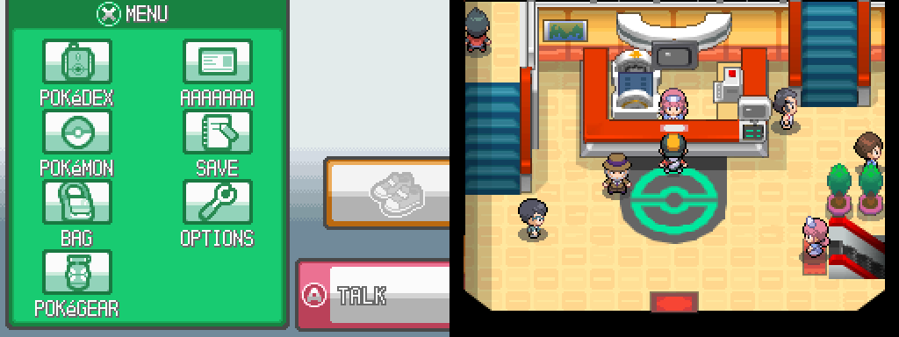
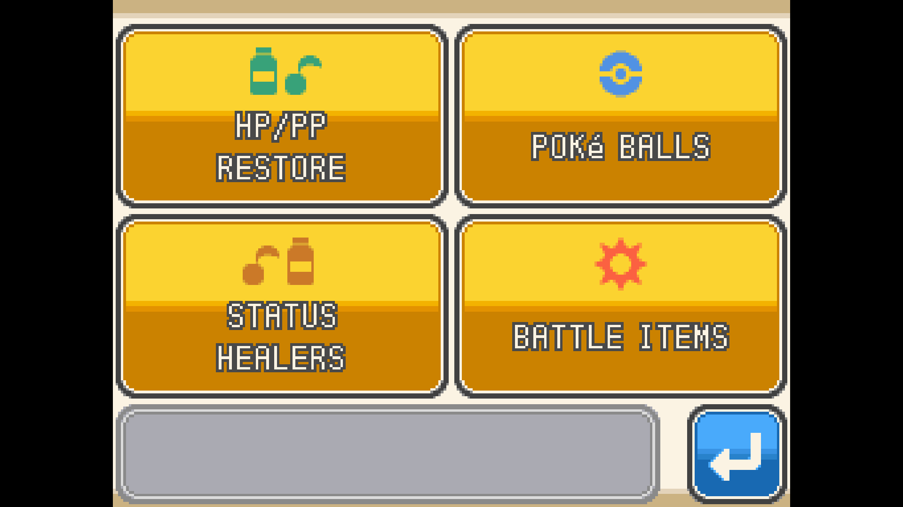

# pokeheartgold-single-screen

A decompilation of Pokémon HeartGold and SoulSilver with a single-screen
build mode (`SINGLE_SCREEN`). It is the source that
[ssrecomp](https://github.com/ClickingMaster/ssrecomp) recompiles into a native
build of Pokémon SoulSilver for single-screen devices. The code is a fork of
[ctrl-cheeb-del/pokeheartgold](https://github.com/ctrl-cheeb-del/pokeheartgold/tree/master),
itself based on [pret/pokeheartgold](https://github.com/pret/pokeheartgold);
the original tooling and decompilation are pret's work.

Fully decompiled: everything is C/C++ and both ROMs build byte-for-byte in the
normal configuration. The single-screen build changes the game so that
everything fits on one screen: the touch-screen parts of the interface
(battle commands and moves, the bag, the party) are drawn where the top screen
is, and the build publishes its menu and selection state so the ssrecomp
frontend can lay it out for widescreen displays and controllers.

**Made with heavy use of AI.** Nearly all of the changes in this fork were
written by an AI coding assistant (Anthropic's Claude, through Claude Code),
directed and play-tested by the maintainer. Expect bugs a person would not have
made, and review the code with that in mind before reusing it.

**This repository contains no game assets.** You need your own copy of the
game to build a ROM; see [INSTALL.md](INSTALL.md).

Not affiliated with or endorsed by Nintendo, Game Freak, The Pokémon Company or
pret. Pokémon is a trademark of its owners. pret does not accept AI-generated
code and does not want to be associated with this, so do not send anything from
here upstream or ask them about it.

## Screenshots

The single-screen ROM running in the [ssrecomp](https://github.com/ClickingMaster/ssrecomp) frontend, drawn across a 16:9 screen:

| | |
|---|---|
|  |  |
|  |  |

## Downloads

Setup programs for Windows and Linux are on the [Releases page](https://github.com/ClickingMaster/pokeheartgold-single-screen/releases/latest):

- `pokeheartgold-single-screen-setup-windows-x86_64.exe`
- `pokeheartgold-single-screen-setup-linux-x86_64`

What you give the setup program:

- **mwccarm:** a folder or zip with `mwccarm/2.0/sp2p2/mwccarm.exe`.
- **Nitro SDK:** one folder or zip holding `tools/bin`, `ARM9-TS.lcf.template`, `ARM7-TS.lcf.template`, `mwldarm.response.template` and, next to each other, the library folders `NitroSDK`, `NitroSystem`, `NitroDWC`, `NitroWiFi`, `MSL_C`, `libCPS`, `libVCT`, `asm`, `src` and `include`.
- **ROM:** your own SoulSilver (USA) `.nds`.

On Linux you also need `make`, `python3`, `pkg-config`, `arm-none-eabi-gcc` and `wine`. The setup tells you what is missing.

They carry the source only. You supply your own mwccarm compiler, the Nitro SDK (tools and the `lib/` library sources) and your own SoulSilver (USA) ROM, from which the setup extracts the raw game files (the remaining sources are fetched from pret/pokeheartgold by `tools/fetch_assets.py`, see [INSTALL.md](INSTALL.md)); the setup places them, checks your build tools and builds `SoulSilver-single-screen.nds`. No ROM, compiler or SDK is distributed, and only the part of `files/` that matches upstream pret/pokeheartgold is tracked. See [INSTALL.md](INSTALL.md) for the build tools each platform needs.

## Building

Setup is in [INSTALL.md](INSTALL.md). The single-screen build is for **SoulSilver (USA)**; it is the only version the setup programs and asset script are tested with. This repository's build system can also make the following ROMs:

* **pokeheartgold.us.nds** `sha1: 4fcded0e2713dc03929845de631d0932ea2b5a37`
* **pokesoulsilver.us.nds** `sha1: f8dc38ea20c17541a43b58c5e6d18c1732c7e582`

To play the single-screen build you do not need to build this by hand:
[ssrecomp](https://github.com/ClickingMaster/ssrecomp)'s setup program builds
it from your ROM and recompiles the result.

## Progress

## Notes and credits

* [docs/DECOMP-NOTES.md](docs/DECOMP-NOTES.md): work log of the decompilation.
* [CREDITS.md](CREDITS.md): credits.

## License and attribution

This is a fork of [ctrl-cheeb-del/pokeheartgold](https://github.com/ctrl-cheeb-del/pokeheartgold/tree/master),
which is based on [pret/pokeheartgold](https://github.com/pret/pokeheartgold)
(the decompilation by the pret community and its contributors), with the
single-screen changes added on top. It follows pret's terms; the single-screen
changes are offered under the same terms.

Pokémon HeartGold and SoulSilver, and the game data and graphics under
`files/`, belong to Nintendo, Creatures Inc. and GAME FREAK inc. This project
is unofficial and not affiliated with or endorsed by them. It contains no ROM,
Nintendo SDK or compiler: you supply your own legally obtained SoulSilver (USA)
ROM, and the tools listed in [INSTALL.md](INSTALL.md).

## License

The single-screen changes and the recompilation frontend (`frontend/`) by ClickingMaster are released under the MIT license (see `frontend/LICENSE`), with the added requirement that derivative works credit "ClickingMaster" by name. The rest of the repository is the upstream pokeheartgold decompilation and is covered by its original terms (upstream has no license file); bundled tools in `tools/` keep their own licenses. No game assets are included, and the game itself belongs to Nintendo, Game Freak and The Pokémon Company.
