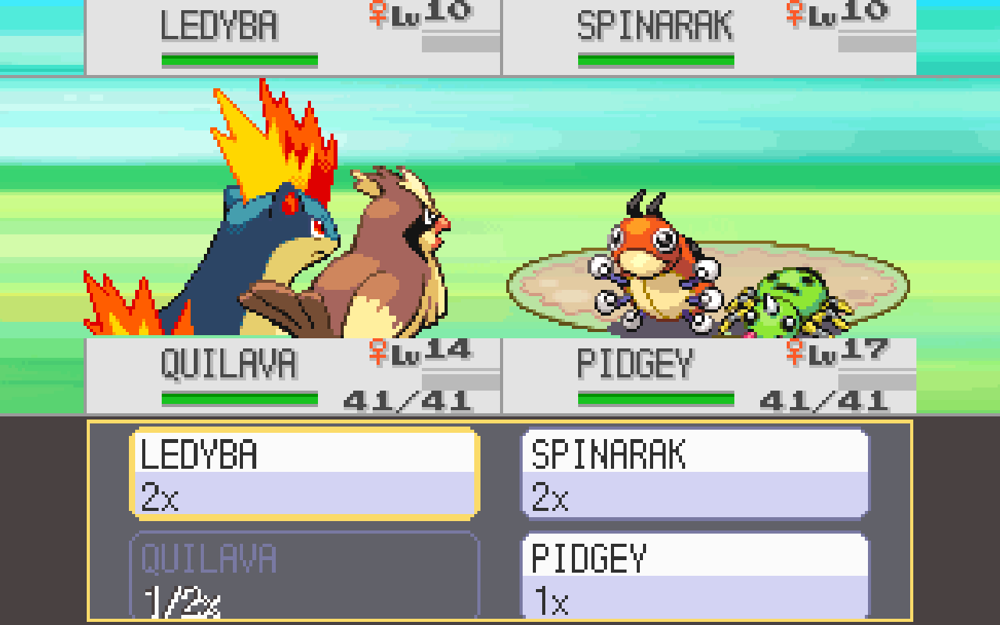

# Doubles battle layout

The original doubles health panels and lower target window obscure the player
Pokémon and target names in the single-screen view. Four compact 128×24 cards
now reserve y0–23 for opponents and y104–127 for the player. The shared doubles
Pokémon/ball base is y64, leaving the middle of the screen for the battle.
Target cards occupy y128–191, retaining the original opponent/ally order,
legal-target callbacks, d-pad navigation and B cancellation. Touch rectangles
match the four visible cards; cancellation remains available from buttons.

All four existing HP cells use the same two 64×64 objects and character layout.
The compact writer reuses the supplied nickname, number, gender, status and
48-pixel gauge graphics. Enemy cards never display numeric HP. VRAM writes stay
aligned halfwords, and singles plus ordinary two-screen builds retain their
original routes. No assets, story, roster, save structures or battle rules change.

Pokémon creation, ball placement, screen anchors, particle anchors and position
resets share the compact coordinates. Version 2 of the existing single-screen
tag publishes the doubles layout to the native frontend. That frontend keeps
all four Pokémon in the game's coordinates rather than applying its singles
movement heuristic. Both game and native executable must be rebuilt together;
the frontend continues to recognise version 1 game builds.

## Validation

Run `python3 -m unittest discover -s tests -p 'test_doubles_*.py' -v`.
The six host checks execute production C/C++ with synthetic renderer/SDK edges:
target geometry and touch order, original-build coordinate routes, ball/reset/
particle alignment, compact VRAM bounds and enemy HP privacy, and four intact
Pokémon with connected HP rows over several widescreen extensions. The compact
writer also runs with address/undefined-behavior sanitizers.

The eight changed game units compile with the genuine SDK and QoL disabled;
the portable native frontend translation unit compiles too. The classic QoL
integration build was rebuilt and checked in a genuine Twins doubles battle,
including target changes, B cancellation, both turns, attacks, fainting and a
level-up. Instruction comparison passes 3,100 cold-boot frames and 1,200 resumed
battle frames. Six CPU compositions cover 4:3, 16:10, 16:9, small, smoothed and
widescreen-disabled views; a Cocoa/Metal fullscreen run includes GPU readback.

The integration screenshot includes optional effectiveness labels from the local
QoL build. This standalone patch keeps upstream's existing effectiveness behavior.
